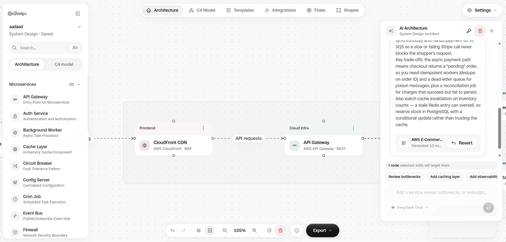

# SysDesign - Systems Architecture & C4 Modeling Studio

SysDesign is a web-based studio for designing, visualizing, and documenting system architectures and C4 models. Built with TanStack Start, React 19, and React Flow, it combines a drag-and-drop component registry, an AI Architect, reference blueprints, and multi-format code/image exports.

## Preview

| **AI-Generated Architecture** | **Chat Architecture Template** | **Fintech Architecture Template** |
| :---: | :---: | :---: |
|  |  |  |

## Key Features

- **AI Architect (BYOK)**: Generate full production architectures from natural language, incrementally add or modify components, or ask for architecture reviews using your own **OpenAI**, **Anthropic (Claude)**, **Google (Gemini)**, or **DeepSeek** API key.
- **Component Registry**: Pre-built catalog of microservices, cloud infrastructure (AWS, GCP, Azure), databases, queues, security, observability, AI/ML, and C4 elements, backed by Supabase with local fallback.
- **System Design & C4 Modes**: Switch between freeform System Architecture and C4 Model (`Context`, `Container`, `Component`, `Code`) views per workspace.
- **Reference Blueprints**: 6 production-grade Architecture and C4 starter templates at `/templates` with live SVG topology previews.
- **Smart Connectivity & Layout**: Automatic tier-ordered Dagre layout, facing edge handles, animated flow edges, editable edge labels, grouping boundaries, undo/redo, and 20px grid snapping.
- **Cloud & Local Persistence**: Sync projects to Supabase with Google OAuth, or work offline in `localStorage` with automatic migration on sign-in.
- **Multi-Format Export**: Export diagrams as high-resolution **PNG**, **SVG**, **Mermaid** (`diagram.mmd` with subgraphs and edge labels), **Terraform HCL** (`main.tf`), and **Structurizr DSL** (`workspace.dsl`).

---

## Using the AI Architect

SysDesign includes a tool-calling AI Architect that inspects your live canvas and the verified component registry to build or refine diagrams.

1. **Open the AI Drawer**: Click the sparkle button on the right edge of the canvas.
2. **Add an API Key**: Click the key icon (or **Configure API Keys**) and enter a key for any supported provider:
   - **OpenAI** (`GPT-6.2 Sol`, `GPT-6.2 Astra`, `GPT-6 Luna`)
   - **Claude (Anthropic)** (`Claude Sonnet 5.5`, `Claude Opus 5.5`, `Claude Haiku 5.5`)
   - **Gemini (Google)** (`Gemini 4 Argon`, `Gemini 4 Carbon`, `Gemini 4 Hydrogen`, `Gemini 3.8 Flash`)
   - **DeepSeek** (`DeepSeek Chat`, `DeepSeek Reasoner`)
   Your keys are stored locally in browser `localStorage` and are never persisted on the server.
3. **Choose a Model**: Use the model selector in the prompt composer footer to switch providers or models at any time.
4. **Prompt the Architect**:
   - **Generate a full system**: *"Design an e-commerce system on AWS with API Gateway, product catalog, checkout, payment worker, SQS queue, PostgreSQL, and Redis cache."*
     The AI looks up verified cloud/registry subtypes, places nodes in clean left-to-right tiers, groups related tiers into boundaries, and labels every connection.
   - **Edit an existing diagram**: *"Add a Redis cache in front of PostgreSQL"* or *"Swap Kafka for SQS"* — modifies your current canvas without erasing existing work.
   - **Ask for a review**: *"Where are the bottlenecks or single points of failure?"* — replies with architectural guidance without modifying the diagram.
   - **Revert**: Every AI edit is recorded as a single undoable step (`Revert` button in chat or `Cmd/Ctrl + Z`).

---

## Reference Blueprints

Browse and preview all blueprints at `/templates` before placing them onto your active canvas:

### System Architectures

- **Global E-Commerce Platform** (`ecommerce-platform`): High-throughput microservices architecture with edge CDN, Kubernetes API gateway, Kafka event streaming, Redis caching, and Aurora PostgreSQL.
- **Real-Time Chat & Messaging Engine** (`realtime-chat-platform`): Low-latency real-time collaboration engine featuring WebSocket gateway clusters, distributed message broker, presence caching, and ScyllaDB history storage.
- **Fintech Payments & Fraud Engine** (`fintech-payment-engine`): PCI-DSS compliant payment processing engine with distributed tokenization vault, real-time ML fraud scoring, and multi-region ACID ledger.

### C4 Model Blueprints

- **Enterprise Banking System (C4 Model)** (`banking-c4-system`): C4 Model representing an enterprise digital banking system with customer personas, containerized web and mobile apps, API gateway, core services, and external mainframe integrations.
- **Telehealth & Clinical EHR Platform (C4 Model)** (`telehealth-ehr-c4`): C4 Model for a HIPAA-compliant telehealth platform with patient portal, physician consultation console, WebRTC streaming gateway, and FHIR clinical records service.
- **Ride-Hailing & Dynamic Dispatch (C4 Model)** (`ridehailing-c4-system`): C4 Model representing a global ride-hailing dispatch system with rider/driver personas, real-time geospatial location tracking, matching engine, and external payment and mapping providers.

---

## Technology Stack

- **Core Framework**: [TanStack Start](https://tanstack.com/start) (React 19 + Vite 8 + Nitro)
- **Routing**: [TanStack Router](https://tanstack.com/router) (File-based)
- **State Management**: [TanStack Store](https://tanstack.com/store)
- **Diagramming Engine**: [XYFlow](https://xyflow.com/) (React Flow) + [Dagre](https://github.com/dagrejs/dagre)
- **AI SDK**: [Vercel AI SDK](https://sdk.vercel.ai/) (`ai` + `@ai-sdk/openai` OpenAI-compatible endpoints)
- **Database and Auth**: [Supabase](https://supabase.com/)
- **Styling**: [Tailwind CSS 4](https://tailwindcss.com/) + `@base-ui/react` + [Next Themes](https://github.com/pacocoursey/next-themes)
- **Icons**: [Tabler Icons](https://tabler.io/icons)
- **Testing**: [Vitest](https://vitest.dev/) + [React Testing Library](https://testing-library.com/)

---

## Project Structure

```text
src/
├── components/
│   ├── ai/            # AI Chat Drawer, floating trigger, BYOK settings
│   ├── ai-elements/   # Conversation, message, model selector, prompt input
│   ├── canvas/        # React Flow canvas, custom nodes/edges, node edit modal
│   ├── dashboard/     # Project setup modal
│   ├── export/        # PNG, SVG, Mermaid, Terraform, Structurizr DSL exporters
│   ├── layout/        # Workspace skeleton, footer, mobile notice
│   ├── sidebar/       # Component registry and drag-and-drop palette
│   ├── toolbar/       # Top navigation, C4 level switcher, bottom studio dock
│   └── ui/            # Design system primitives (Button, Input, Dialog, etc.)
├── data/
│   ├── registry/      # Built-in component definitions (AWS, GCP, Azure, etc.)
│   └── templates/     # 6 Architecture and C4 reference blueprints
├── lib/               # AI RPC server function, prompts, layout tools, Supabase client
├── routes/            # File-based TanStack Router pages (/, /$slug, /$slug/c4, /projects, /templates)
├── store/             # TanStack Stores (canvas, projects, AI keys/models, registry)
├── types/             # Shared TypeScript interfaces
└── globals.css        # Design tokens, typography scale, and Tailwind v4 theme
supabase/
├── migrations/        # SQL migrations for catalog_components and catalog_categories
├── seed_catalog_components.sql
└── seed_catalog_categories.sql
```

---

## Local Setup

### 1. Prerequisites

- Node.js (v20+)
- pnpm

### 2. Installation

1. **Clone the repository**:
   ```bash
   git clone https://github.com/your-username/sysdesign.git
   cd sysdesign
   ```

2. **Install dependencies**:
   ```bash
   pnpm install
   ```

3. **Configure Environment Variables**:
   Create a `.env` file in the root directory:
   ```env
   VITE_SUPABASE_URL=https://your-project.supabase.co
   VITE_SUPABASE_ANON_KEY=your-anon-key
   ```

4. **Start the development server**:
   ```bash
   pnpm dev
   ```
   Open `http://localhost:3000` in your browser.

---

## Supabase Setup and Seeding

SysDesign uses Supabase for Google authentication, cloud project persistence, and the dynamic component/category catalog.

### 1. Environment Variables

| Variable | Required | Description |
| :--- | :--- | :--- |
| `VITE_SUPABASE_URL` | **Yes** | Your Supabase project URL (Project Settings > API). |
| `VITE_SUPABASE_ANON_KEY` | **Yes** | Your Supabase anon / public API key. |

### 2. Create the `projects` Table

Run the following SQL in the Supabase SQL Editor:

```sql
create table if not exists public.projects (
  id uuid primary key default gen_random_uuid(),
  user_id uuid references auth.users not null,
  name text not null,
  slug text not null,
  type text not null default 'design',
  description text,
  nodes jsonb default '[]'::jsonb,
  edges jsonb default '[]'::jsonb,
  edge_counter int default 0,
  created_at timestamp with time zone default now(),
  updated_at timestamp with time zone default now()
);

alter table public.projects enable row level security;

create policy "Users can only access their own projects"
  on public.projects for all
  using (auth.uid() = user_id)
  with check (auth.uid() = user_id);
```

### 3. Run Catalog Migrations and Seed Data

Run the repository's SQL files in the Supabase SQL Editor in the following order:

1. `supabase/migrations/20261118_catalog_components.sql` (creates `catalog_components` table and RLS read policy)
2. `supabase/migrations/20261119_catalog_categories.sql` (creates `catalog_categories` table and RLS read policy)
3. `supabase/seed_catalog_components.sql` (seeds all built-in components; regenerate anytime from `src/data/registry/` with `pnpm run catalog:seed`)
4. `supabase/seed_catalog_categories.sql` (seeds light/dark palette tokens for all 12 categories)

If the catalog tables are empty or unreachable, the app automatically falls back to the bundled registry in `src/data/registry/`.

### 4. Enable Google Authentication

Go to **Supabase > Authentication > Providers > Google**, enable the provider, and add your Google OAuth Client ID and Client Secret from the Google Cloud Console. Add `http://localhost:3000` and your production URL to **Authentication > URL Configuration > Redirect URLs**.

---

## Road Map

- [x] **AI-Assisted Design**: Tool-calling AI Architect with BYOK support for OpenAI, Anthropic, Google Gemini, and DeepSeek.
- [ ] **Dockerization**: Containerize the app for easier deployment and isolation.
- [ ] **Multi-User Editing**: Real-time collaborative diagramming via Supabase Realtime.
- [ ] **Shareable Links**: Generate public read-only URLs for architecture designs.

---

## License

Free to use under the MIT License.
